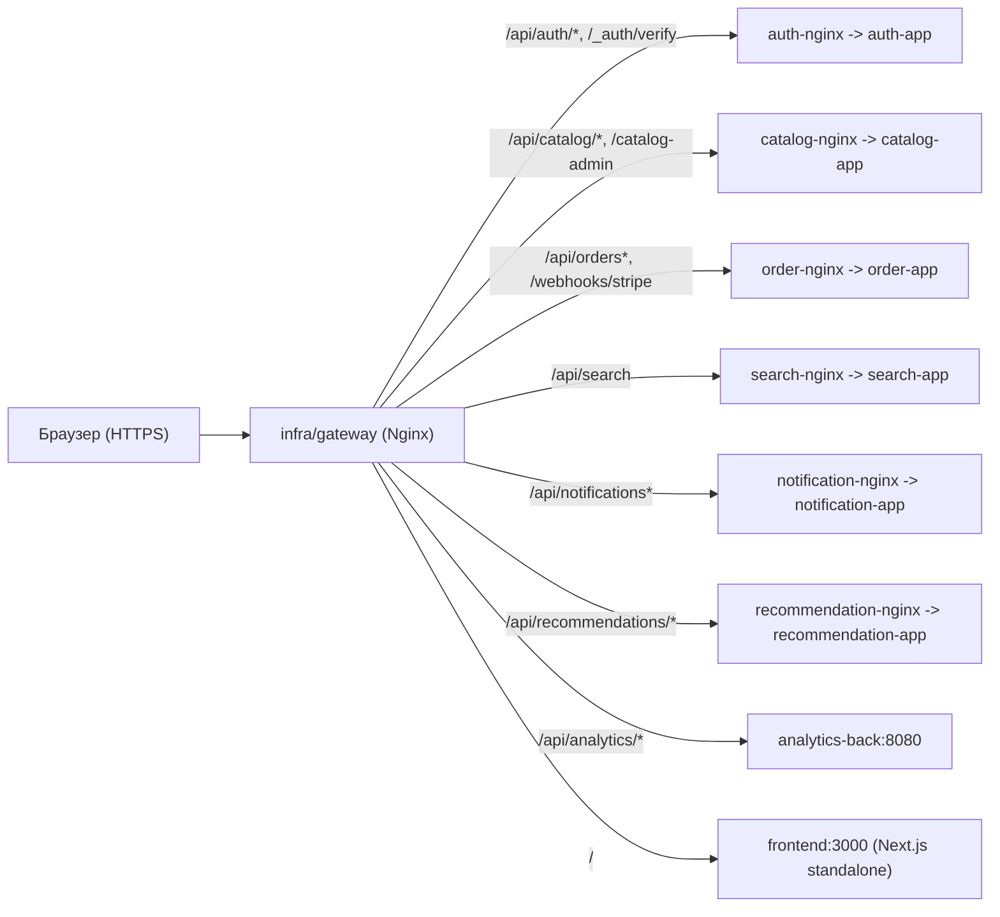
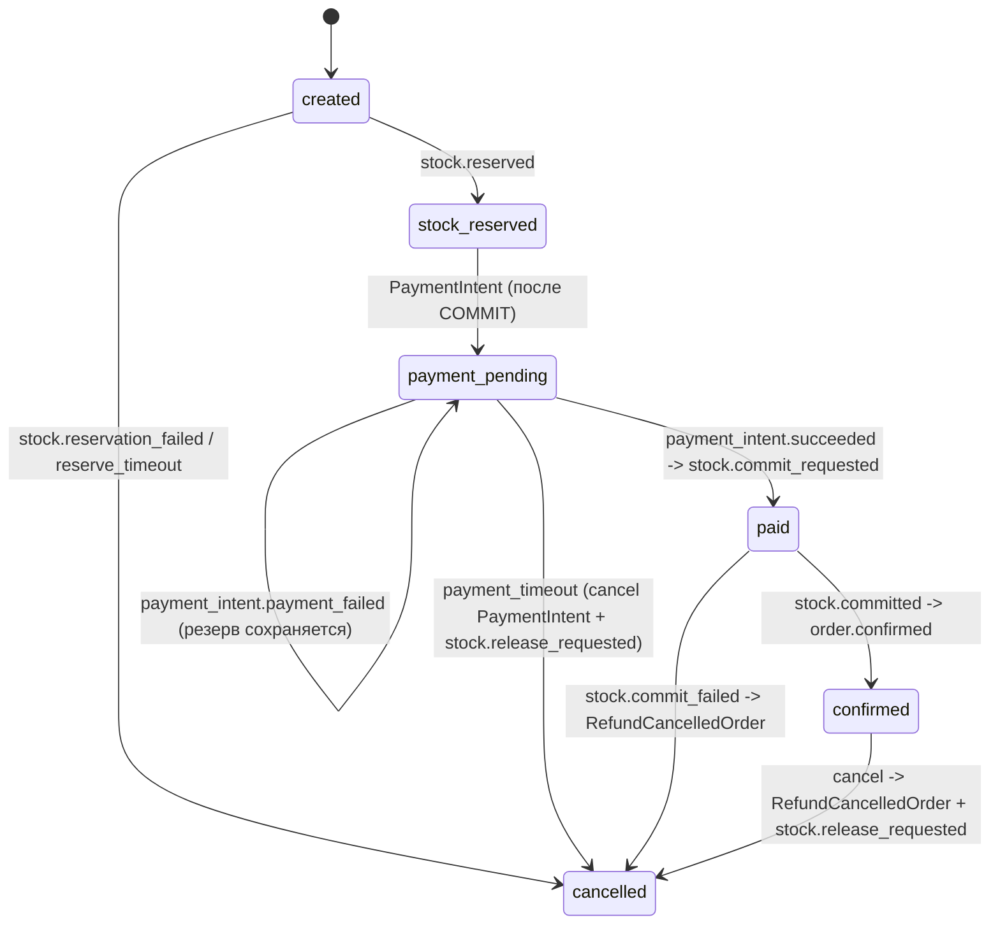

# InnoTrainne — E-Commerce микросервисная платформа

Монорепозиторий интернет-магазина из 7 микросервисов, общего пакета `packages/platform-kit`, фронтенда на Next.js 16 и единого `infra/gateway` на Nginx.

## Состав платформы

| Компонент | Стек | Путь в Gateway | Хранилища | Топики / очереди (вход → выход) | Локальная проверка |
|---|---|---|---|---|---|
| `auth-service` | Laravel 13, PHP 8.5 | `/api/auth/*`, `/api/me`, `/api/profile/*`, `/api/admin/*`, `/_auth/*` | PostgreSQL (`auth_db`), Redis (`auth-redis`) | `database` очередь `auth-events` → Kafka `auth.events`, RabbitMQ `analytics.events` | `cd auth-service && composer check` |
| `catalog-service` | Laravel 13, Filament 3, PHP 8.5 | `/api/catalog/*`, `/catalog-admin`, `/media/catalog-images/*` | PostgreSQL (`catalog_db`), Redis (`catalog-redis`), MinIO | Kafka `order.events`, `stock.commands` → Outbox → Kafka `catalog.events`, `inventory.events` | `cd catalog-service && composer check` |
| `order-service` | Laravel 13, Stripe SDK, PHP 8.5 | `/api/orders*`, `/webhooks/stripe` | PostgreSQL (`order_db`), Redis (`order-redis`) | Kafka `catalog.events`, `inventory.events`, Stripe Webhooks → Outbox → Kafka `order.events`, `stock.commands`, RabbitMQ `analytics.events` | `cd order-service && composer check` |
| `search-service` | Laravel 13, Elasticsearch 8.15, PHP 8.5 | `/api/search` | Elasticsearch, Redis (`search-redis`) | Kafka `catalog.events` → Redis очередь `search-events` → RabbitMQ `analytics.events` | `cd search-service && composer check` |
| `notification-service` | Laravel 13, MongoDB, PHP 8.5 | `/api/notifications*` | MongoDB (`notification_service`), SMTP (`mailpit` в dev) | Kafka `auth.events`, `order.events` → SMTP (с дедупликацией по `event_id` и DLQ) | `cd notification-service && composer check` |
| `recommendation-service` | Symfony 8.1, Doctrine, Gemini API, PHP 8.5 | `/api/recommendations/*` | PostgreSQL + `pgvector`, Redis (`recommendation-redis`) | Kafka `catalog.events` → HNSW векторный индекс (Messenger failure transport `failed`) | `cd recommendation-service && composer check` |
| `analytics-service` | Go 1.25+, ClickHouse, RabbitMQ 4 | `/api/analytics/*` | ClickHouse (`analytics`) | RabbitMQ `analytics.events` (quorum + DLX `analytics.events.dlq`) → батчи в `ReplacingMergeTree` | `cd analytics-service && go test -race ./...` |
| `frontend` | Next.js 16.4 (App Router, standalone), React 19, TypeScript | `/` | Cookie `__Host-access` / `refresh_token` (`HttpOnly`) | REST через `infra/gateway` + Stripe PaymentElement | `cd frontend && npm run check && npm run build` |
| `packages/platform-kit` | PHP 8.5 библиотека | — | — | Проверка RS256 JWT по JWKS, Laravel guard `api`, RFC 9457 `problem+json`, `EventEnvelope`, `AnalyticsPublisher` | `cd packages/platform-kit && composer check` |

---

## Быстрый старт с нуля

Потребуются Docker, Docker Compose и [mkcert](https://github.com/FiloSottile/mkcert#installation) (только для локального HTTPS).

```bash
git clone <url-репозитория> shop
cd shop
ADMIN_EMAIL=admin@example.test ./start.sh --seed
```

Что делает `./start.sh`:
1. Генерирует `.env` (с правами `600`) со случайными паролями для PostgreSQL, Redis (`--requirepass`), MongoDB, RabbitMQ, ClickHouse, MinIO, `APP_KEY` сервисов и ключами RS256 + `jwks.json` в `.secrets/jwt/`.
2. Выпускает локальный TLS-сертификат через `mkcert` в `infra/certs/`. Ключи Stripe не обязательны: без них сайт и вход работают, оплата картой нет. Если в `.env` уже есть `sk_test_...` и `pk_test_...`, скрипт поднимает `stripe-cli`.
3. Собирает базовый образ `ecommerce-php-base:8.5` и единый multi-stage образ `infra/php/laravel.Dockerfile` (в `local`-режиме подключает `compose.dev.yaml` с `axllent/mailpit` на `http://127.0.0.1:8025` и bind-mount исходников под вашим `UID:GID`).
4. Поднимает инфраструктуру, создаёт топики и DLQ через `kafka-init` (`KAFKA_AUTO_CREATE_TOPICS_ENABLE=false`), накатывает миграции, создаёт первого администратора (`ADMIN_EMAIL`) и проверяет готовность всех контейнеров.

Остановка всего стека:
```bash
./stop.sh
```

Режимы запуска:
- `START_ENV=local ./start.sh` (по умолчанию) — `compose.yaml` + `compose.dev.yaml`.
- `START_ENV=ci ./start.sh` — только `compose.yaml` (без bind-mount и dev-инструментов).
- `START_ENV=stage` — деплой готовых образов из GHCR с бэкапом БД, миграциями, smoke-проверкой и автоматическим откатом (`scripts/deploy/stage-remote.sh`).

---

## Архитектура маршрутизации и безопасности



- **Двухуровневая защита (Defense in Depth):**
  1. На периметре `infra/gateway` превращает cookie `__Host-access` в `Authorization: Bearer`, проверяет активность сессии/отзыв токена через `auth_request /_auth/verify` и закрывает S3 API MinIO (доступен только `GET`/`HEAD` объектов `/media/catalog-images/*`) и Swagger UI.
  2. Внутри периметра каждый сервис самостоятельно валидирует RS256-подпись, `iss`, `aud`, `exp`, `nbf` по JWKS (`GET /api/v1/internal/jwks`) и проверяет гранулярные права (`PermissionMap` / Policies / Voters).
- **Сегментация сети Docker:** каждый сервис подключён только к своей изолированной `internal: true` сети данных (`auth-data`, `catalog-data`, `order-data`, `search-data`, `notification-data`, `recommendation-data`, `analytics-data`). Доступ к чужой БД или чужому Redis на сетевом уровне невозможен.

---

## Сага заказа и контракты событий

Все межсервисные события передаются в едином конверте `EventEnvelope` (`schema_version: 1`, `docs/events/*.schema.json`, эталонные фикстуры в `contracts/*/*.json`, проверка `php scripts/ci/verify-contracts.php`).



### Оплата Stripe локально
1. Укажите в корневом `.env` тестовые ключи из [Stripe Dashboard](https://dashboard.stripe.com/test/apikeys): `STRIPE_SECRET_KEY` (`sk_test_...`) и `STRIPE_PUBLISHABLE_KEY` (`pk_test_...`).
2. Тестовые карты:
   - `4242 4242 4242 4242` — успешная оплата (`paid` → списание резерва на складе → `confirmed`).
   - `4000 0000 0000 0002` — отказ карты (заказ остаётся в `payment_pending` с удержанным резервом и может быть оплачен повторно).
   - Неоплаченные заказы автоматически отменяются планировщиком `order:expire-orders` через `ORDER_PAYMENT_TTL_MINUTES` (по умолчанию 30 мин), а страховочный TTL резервов склада `CATALOG_RESERVATION_TTL_MINUTES` (45 мин) снимает зависшие брони.

### DLQ и восстановление после сбоев
Все Kafka-консьюмеры работают в режиме ручного коммита после обработки (`auto.offset.reset=earliest`) и перенаправляют битые или исчерпавшие попытки сообщения в `<topic>.dlq.<consumer-service>`:

```bash
# Просмотр и переигрывание DLQ
docker compose exec catalog-order-consumer php artisan catalog:replay-dlq order.events.dlq.catalog-service
docker compose exec catalog-order-consumer php artisan catalog:replay-dlq order.events.dlq.catalog-service --replay
docker compose exec order-inventory-consumer php artisan order:replay-dlq inventory.events.dlq.order-service --replay
docker compose exec search-catalog-consumer php artisan search:replay-dlq catalog.events.dlq.search-service --replay

# Возврат dead-сообщений outbox в очередь отправки
docker compose exec order-outbox-relay php artisan order:retry-outbox --failed
```

---

## Ротация RS256-ключа access-токена и правила работы с секретами

1. Закрытый ключ монтируется **только** в `auth-app` (`.secrets/jwt/current.pem`, `JWT_ACCESS_KID=auth-1`).
2. Для бесшовной ротации переименуйте `current.{pem,pub.pem}` в `previous.{pem,pub.pem}`, сгенерируйте новую пару `current.{pem,pub.pem}`, выполните:
   ```bash
   JWT_ACCESS_KID=auth-2 JWT_ACCESS_PREVIOUS_KID=auth-1 php scripts/jwt/write-jwks.php .secrets/jwt
   ```
   и перезапустите `auth-app`. Старые токены продолжат проверяться по предыдущему `kid` до истечения TTL.
3. Правила хранения секретов описаны в [SECURITY.md](./SECURITY.md). Для включения локального pre-commit сканера `gitleaks`:
   ```bash
   git config core.hooksPath githooks
   ```

Правила оформления кода, структуры директорий (`docs/architecture/layout.md`) и обязательных проверок описаны в [CONTRIBUTING.md](./CONTRIBUTING.md).
